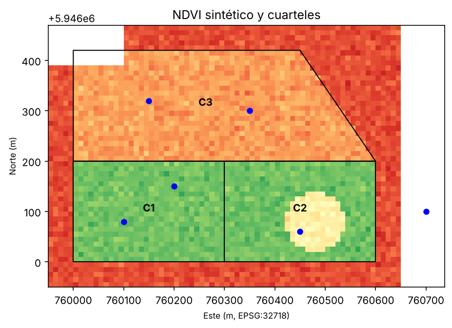
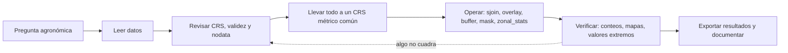

# Panorama: de las geometrías al análisis ráster–vector

!!! question "Pregunta guía"
    ¿Cómo respondo con código las preguntas que hoy resuelvo con clics en un SIG: cuántas hectáreas, qué muestra cae en qué cuartel, cuál es el NDVI medio por sector?

> **Cómo leer este capítulo.** Es un recorrido completo, de punta a punta, por las herramientas de la parte. Los capítulos 2 al 8 profundizan cada tema por separado; si algo aquí te parece rápido, allí está el detalle. Todo el código fue ejecutado y los resultados que aparecen en los comentarios son los obtenidos.

**Nivel:** principiante.  
**Conocimientos previos:** Python básico (variables, listas, funciones), nociones de `pandas` y de `numpy`. No se requiere experiencia previa con SIG.  
**Propósito:** aprender a representar, transformar y combinar datos geográficos con Python. Este capítulo trata problemas que caben en un computador personal: un predio, una comuna o algunas imágenes. Es la base del [capítulo 10, *Datos a escala*](10-datos-a-escala.md), que amplía estas ideas a grandes volúmenes de datos.

Trabajaremos con `shapely`, `geopandas`, `pyproj`, `rasterio`, `rasterstats` y `matplotlib`. Cada una resuelve una parte del problema. Ninguna es obligatoria en todos los análisis, y conviene saber qué hace cada una antes de combinarlas.

### Objetivos de aprendizaje

Al finalizar, podrás:

1. Explicar qué es la geocomputación y en qué se diferencia de usar un SIG de escritorio.
2. Crear y medir geometrías con Shapely, y reconocer que una geometría por sí sola no tiene sistema de coordenadas.
3. Leer, crear, reproyectar, unir y exportar capas vectoriales con GeoPandas.
4. Leer un raster con Rasterio y entender su transformación, su CRS y su valor `nodata`.
5. Combinar vectores y rasters: muestrear puntos, recortar por polígono y calcular estadísticas zonales.
6. Detectar los errores más comunes de principiante antes de que lleguen a una conclusión agronómica.

## 1. ¿Qué es la geocomputación?

La **geocomputación** es el análisis de datos geográficos mediante programación. Las preguntas pueden ser las mismas que se responden con un SIG de escritorio, como QGIS: cuántas hectáreas tiene cada cuartel, qué muestras de suelo caen en cada uno o cuál es el NDVI medio por sector. Lo que cambia es la forma de trabajar.

| Aspecto | SIG de escritorio | Geocomputación con código |
|---|---|---|
| Forma de trabajo | Menús y clics | Instrucciones escritas |
| Repetición | Rehacer los pasos a mano | Volver a ejecutar el script |
| Trazabilidad | Depende de lo que se anote | El código documenta cada paso |
| Escala | Cómoda para pocos archivos | Automatiza decenas o miles de archivos |
| Curva inicial | Más suave | Exige aprender sintaxis |

Ambos enfoques son complementarios. Un agrónomo puede digitalizar parcelas en QGIS y luego analizarlas en Python; también puede revisar visualmente en QGIS un resultado producido con código. Lo importante es que el análisis sea **reproducible**: otra persona, o tú mismo dentro de seis meses, debe poder repetir cada paso y obtener el mismo resultado.

## 2. Repaso: vector, raster y CRS

El [capítulo 2](02-datos-geograficos.ipynb) desarrolla estos conceptos. Aquí los resumimos con el vocabulario que usaremos en el código.

- **Vector:** entidades discretas representadas por puntos, líneas o polígonos, cada una con atributos. Por ejemplo, un punto de muestreo de suelo con su materia orgánica, un canal de riego o un cuartel con su cultivo. En Python: Shapely y GeoPandas.
- **Raster:** una cuadrícula de celdas (píxeles) donde cada celda guarda un valor, como NDVI, elevación o temperatura. En Python: Rasterio, que entrega los valores como arrays de NumPy.
- **CRS (sistema de referencia de coordenadas):** indica qué significan los números de las coordenadas. `EPSG:4326` usa grados de longitud y latitud. `EPSG:32718` (UTM zona 18 sur) usa metros y es adecuado para la zona centro-sur de Chile, aproximadamente entre los 78° y 72° de longitud oeste.

> **Regla de oro:** los grados no son metros. Para medir áreas, distancias o hacer buffers, las capas deben estar en un CRS proyectado con unidades métricas adecuado a la zona.

## 3. Preparar el entorno

En un notebook de Jupyter:

```python
%pip install geopandas rasterio rasterstats matplotlib
```

GeoPandas instala también `shapely`, `pyproj` y `pyogrio` (el motor de lectura y escritura de archivos vectoriales). En una terminal se usa `python -m pip install` con la misma lista. En Windows, si `pip` falla al compilar dependencias, conda suele resolverlas mejor: `conda install -c conda-forge geopandas rasterio rasterstats`.

Los ejemplos de este capítulo se ejecutaron con geopandas 1.2.0, shapely 2.2.0, pyproj 3.8.0, rasterio 1.5.2 y rasterstats 0.21.0. En un proyecto propio, registra tus versiones:

```python
import geopandas, shapely, pyproj, rasterio
for lib in (geopandas, shapely, pyproj, rasterio):
    print(lib.__name__, lib.__version__)
```

## 4. Shapely: la geometría pura

Shapely representa figuras geométricas en un plano y calcula sus relaciones. Es el "motor de geometría" que usa GeoPandas por debajo.

### 4.1. Crear geometrías

```python
from shapely.geometry import Point, LineString, Polygon

pozo = Point(30, 20)                                      # un punto
camino = LineString([(0, -10), (120, -10), (120, 60)])    # una línea
parcela = Polygon([(0, 0), (100, 0), (100, 50), (0, 50)]) # un polígono

print(parcela.wkt)
# POLYGON ((0 0, 100 0, 100 50, 0 50, 0 0))
```

Shapely cierra el anillo automáticamente: el primer vértice se repite al final. **WKT** (*Well-Known Text*) es un formato de texto estándar para escribir geometrías; resulta útil para inspeccionarlas o copiarlas.

### 4.2. Medir

```python
print(parcela.area)      # 5000.0
print(parcela.length)    # 300.0  (perímetro)
print(parcela.centroid)  # POINT (50 25)
print(parcela.bounds)    # (0.0, 0.0, 100.0, 50.0) -> (minx, miny, maxx, maxy)
print(camino.length)     # 190.0
```

¿Son 5000 m² o 5000 km²? **Shapely no lo sabe.** Una geometría de Shapely es un conjunto de números en un plano cartesiano, sin CRS ni unidades. Las unidades dependen de cómo se obtuvieron las coordenadas. Por eso, en el trabajo cotidiano usaremos GeoPandas, que asocia un CRS a cada capa.

### 4.3. Relaciones espaciales (predicados)

Los **predicados** responden preguntas de verdadero o falso:

```python
print(parcela.contains(pozo))   # True: el pozo está dentro de la parcela
print(pozo.within(parcela))     # True: misma relación, vista desde el punto
print(pozo.distance(camino))    # 30.0

vecina = Polygon([(80, 20), (150, 20), (150, 80), (80, 80)])
print(parcela.intersects(vecina))  # True: comparten superficie
```

| Predicado | Pregunta | Ejemplo agronómico |
|---|---|---|
| `contains` / `within` | ¿Uno está dentro del otro? | ¿La muestra cayó dentro del cuartel? |
| `intersects` | ¿Tienen algún punto en común? | ¿El cuartel toca la zona de exclusión? |
| `touches` | ¿Solo comparten borde? | ¿Dos cuarteles son colindantes? |
| `disjoint` | ¿No se tocan en absoluto? | ¿La parcela está fuera del área de riego? |

### 4.4. Operaciones que crean geometrías nuevas

```python
print(parcela.intersection(vecina).area)  # 600.0   superficie común
print(parcela.union(vecina).area)         # 8600.0  superficie total combinada
print(parcela.difference(vecina).area)    # 4400.0  parcela sin la parte vecina

borde_interno = parcela.buffer(-5)        # buffer negativo: retrae 5 unidades
print(borde_interno.area)                 # 3600.0  (90 x 40)
```

El **buffer** es una de las operaciones más útiles en agronomía. Un buffer positivo crea una franja alrededor de un objeto, por ejemplo una zona de exclusión de aplicación junto a un curso de agua. Un buffer negativo elimina el borde de un polígono, lo que permite descartar píxeles de borde, que suelen mezclar cultivo y camino.

### 4.5. Geometrías inválidas

Un polígono cuyo contorno se cruza a sí mismo (un "corbatín") es **inválido**. Las operaciones sobre él pueden fallar o dar resultados incorrectos:

```python
from shapely import make_valid
from shapely.validation import explain_validity

corbatin = Polygon([(0, 0), (10, 10), (10, 0), (0, 10)])
print(corbatin.is_valid)            # False
print(explain_validity(corbatin))   # Self-intersection[5 5]

reparado = make_valid(corbatin)
print(reparado.geom_type, reparado.area)  # MultiPolygon 50.0
```

Los polígonos digitalizados a mano o descargados de distintas fuentes suelen tener este problema. Comprobar `is_valid` debe ser un paso habitual después de leer una capa.

## 5. GeoPandas: tablas con geometría

GeoPandas extiende `pandas` con una columna especial, `geometry`. Un **GeoDataFrame** es una tabla donde cada fila es una entidad, con sus atributos y su geometría, y donde la tabla completa tiene un CRS.

### 5.1. Leer y explorar una capa

```python
import geopandas as gpd

predios = gpd.read_file("predios.shp")      # también .gpkg, .geojson, .kml...
print(predios.head())       # primeras filas
print(predios.crs)          # sistema de referencia
print(predios.geom_type.value_counts())
print(predios.total_bounds) # extensión: [minx, miny, maxx, maxy]
print(predios.is_valid.all())
```

`read_file` lee la mayoría de los formatos vectoriales. Si el archivo tiene varias capas (como un GeoPackage), se elige con `layer="nombre"`.

| Formato | Ventajas | Limitaciones |
|---|---|---|
| Shapefile (`.shp`) | Muy difundido | Varios archivos por capa, nombres de columna de máximo 10 caracteres, sin fechas con hora |
| GeoPackage (`.gpkg`) | Un solo archivo, varias capas, sin límites de nombres | Menos conocido por algunos usuarios |
| GeoJSON (`.geojson`) | Texto legible, ideal para web | Archivos grandes con muchas geometrías; por norma usa EPSG:4326 |

**Recomendación:** usa GeoPackage para guardar tus resultados.

### 5.2. Crear un GeoDataFrame desde cero

En este capítulo usaremos un **predio ficticio** cerca de Chillán, Región de Ñuble, con tres cuarteles. Las coordenadas son inventadas, para que el ejemplo funcione sin descargar nada:

```python
import numpy as np
import pandas as pd
import geopandas as gpd
from shapely.geometry import Polygon, box

x0, y0 = 760_000, 5_946_000   # esquina suroeste del predio, en metros UTM 18S

cuarteles = gpd.GeoDataFrame(
    {
        "cuartel": ["C1", "C2", "C3"],
        "cultivo": ["maiz", "maiz", "trigo"],
    },
    geometry=[
        box(x0, y0, x0 + 300, y0 + 200),          # rectángulo 300 x 200 m
        box(x0 + 300, y0, x0 + 600, y0 + 200),
        Polygon([(x0, y0 + 200), (x0 + 600, y0 + 200),
                 (x0 + 450, y0 + 420), (x0, y0 + 420)]),
    ],
    crs="EPSG:32718",
)
cuarteles["area_ha"] = (cuarteles.area / 10_000).round(2)
print(cuarteles[["cuartel", "cultivo", "area_ha"]])
```

```text
  cuartel cultivo  area_ha
0      C1    maiz     6.00
1      C2    maiz     6.00
2      C3   trigo    11.55
```

`box(minx, miny, maxx, maxy)` crea rectángulos rápidamente. Como el CRS está en metros, `.area` entrega m², y dividir por 10.000 da hectáreas.

### 5.3. Puntos desde una tabla con coordenadas

Es frecuente recibir muestreos en una planilla con columnas de latitud y longitud, tomadas con un GPS o un celular. Para convertirla en capa:

```python
muestras = pd.DataFrame({
    "id": ["M1", "M2", "M3", "M4", "M5", "M6"],
    "lon": [-72.09244, -72.09135, -72.08853, -72.09197, -72.08973, -72.08575],
    "lat": [-36.59534, -36.59468, -36.59542, -36.59317, -36.59329, -36.59500],
    "mo_pct": [3.1, 2.8, 2.2, 4.0, 3.6, 2.9],   # materia orgánica (%)
})

puntos = gpd.GeoDataFrame(
    muestras,
    geometry=gpd.points_from_xy(muestras["lon"], muestras["lat"]),
    crs="EPSG:4326",          # el GPS entrega grados
).to_crs(cuarteles.crs)       # se pasa a metros para trabajar con los cuarteles
```

Dos detalles en los que se equivocan muchos principiantes:

1. `points_from_xy` recibe **primero x (longitud) y después y (latitud)**. Invertirlas suele ubicar los puntos en otro continente o producir un error.
2. Al crear la capa, `crs=` **declara** en qué sistema están los números; no los transforma. Para transformarlos se usa `to_crs()`.

### 5.4. Asignar un CRS frente a reproyectar

| Método | Qué hace | Cuándo usarlo |
|---|---|---|
| `gdf.set_crs("EPSG:4326")` | Etiqueta la capa sin tocar las coordenadas | La capa no tiene CRS y sabes cuál le corresponde |
| `gdf.to_crs("EPSG:32718")` | Recalcula cada coordenada en el nuevo sistema | Necesitas cambiar de sistema, por ejemplo de grados a metros |

Si asignas un CRS equivocado con `set_crs`, ninguna operación posterior lo va a corregir: los datos quedarán en el lugar equivocado. GeoPandas advierte cuando se calcula un área en grados:

```python
cuarteles.to_crs(4326).area
# UserWarning: Geometry is in a geographic CRS. Results from 'area'
# are likely incorrect...
# 0    0.000006   <- "grados cuadrados": un número sin sentido agronómico
```

`pyproj` permite consultar los detalles de un CRS:

```python
from pyproj import CRS
crs = CRS.from_epsg(32718)
print(crs.name)                       # WGS 84 / UTM zone 18S
print(crs.axis_info[0].unit_name)     # metre
```

### 5.5. Unión espacial: ¿en qué cuartel cayó cada muestra?

La **unión espacial** (`sjoin`) combina dos capas según su relación geométrica, igual que `merge` en pandas combina tablas según una columna común.

```python
union = gpd.sjoin(
    puntos,
    cuarteles[["cuartel", "geometry"]],
    how="left",            # conserva todas las muestras
    predicate="within",    # la muestra debe estar dentro del cuartel
)
print(union[["id", "mo_pct", "cuartel"]])
print(union.groupby("cuartel")["mo_pct"].agg(["count", "mean"]))
```

```text
   id  mo_pct cuartel
0  M1     3.1      C1
1  M2     2.8      C1
2  M3     2.2      C2
3  M4     4.0      C3
4  M5     3.6      C3
5  M6     2.9     NaN       <- fuera del predio

         count  mean
cuartel
C1           2  2.95
C2           1  2.20
C3           2  3.80
```

La muestra M6 cayó fuera de todos los cuarteles. Con `how="left"` aparece con `NaN`, y eso te permite detectarla. Con `how="inner"` habría desaparecido sin aviso. Antes de descartarla, conviene averiguar el motivo: puede ser un error de GPS, un límite de cuartel desactualizado o una muestra tomada en el cuartel vecino.

**Advertencia agronómica:** un promedio calculado con una o dos muestras no representa la variabilidad de un cuartel. El código hace el cálculo, pero decidir si es suficiente corresponde al diseño de muestreo.

### 5.6. Superposición: superficie afectada por una franja de protección

Supongamos que un canal cruza el predio y no se puede aplicar un producto a menos de 15 m de él. ¿Cuántas hectáreas de cada cuartel quedan afectadas?

```python
canal = gpd.GeoSeries.from_wkt(
    [f"LINESTRING ({x0 - 50} {y0 + 60}, {x0 + 650} {y0 + 140})"],
    crs="EPSG:32718",
)
franja = canal.buffer(15)     # 15 m a cada lado, válido porque el CRS está en metros

afectado = gpd.overlay(
    cuarteles,
    gpd.GeoDataFrame(geometry=franja),
    how="intersection",
)
afectado["ha_franja"] = (afectado.area / 10_000).round(2)
print(afectado[["cuartel", "ha_franja"]])
```

```text
  cuartel  ha_franja
0      C1       0.91
1      C2       0.91
```

`overlay` corta las geometrías y produce polígonos nuevos. Las opciones de `how` son `intersection`, `union`, `difference`, `symmetric_difference` e `identity`. `sjoin`, en cambio, no corta nada: solo pega atributos.

### 5.7. Disolver y exportar

**Disolver** fusiona geometrías que comparten un atributo, por ejemplo para obtener la superficie total por cultivo:

```python
por_cultivo = cuarteles.dissolve(by="cultivo", aggfunc={"area_ha": "sum"})
print(por_cultivo[["area_ha"]])
#          area_ha
# cultivo
# maiz       12.00
# trigo      11.55

cuarteles.to_file("predio.gpkg", layer="cuarteles", driver="GPKG")
```

### 5.8. Un mapa rápido

```python
ax = cuarteles.plot(column="cultivo", legend=True, edgecolor="black", figsize=(6, 5))
puntos.plot(ax=ax, color="blue", markersize=20)
ax.set_title("Cuarteles y muestras de suelo")
```

`plot()` sirve para revisar los datos rápidamente. Para mapas interactivos sobre un mapa base existe `gdf.explore()`, que requiere instalar `folium`.

## 6. Rasterio: leer y escribir rasters

Rasterio lee y escribe rasters (GeoTIFF y muchos otros formatos) y entrega las celdas como arrays de NumPy. Se apoya en GDAL, la misma biblioteca que usa QGIS.

### 6.1. Anatomía de un raster

Un raster georreferenciado combina:

- **Array de valores:** matriz de `filas × columnas`, y una o varias **bandas**.
- **Transformación (`transform`):** relaciona fila y columna con coordenadas. Contiene la esquina superior izquierda y el tamaño de píxel.
- **CRS:** igual que en vectores.
- **`nodata`:** valor reservado para "sin dato", por ejemplo una nube o el borde de una escena.
- **Tipo de dato (`dtype`):** `uint8`, `int16`, `float32`, etc. Determina el rango de valores y el espacio en memoria.

> **Ojo con el orden:** en un array la primera posición es la **fila** (eje *y*) y la segunda la **columna** (eje *x*). En coordenadas es al revés: primero *x*, después *y*. Además, la fila 0 está **arriba** (norte) y aumenta hacia el sur.

### 6.2. Crear un raster de práctica

Para no depender de descargas, fabricaremos un raster de NDVI **sintético** de 10 m de resolución sobre el predio. Representa una situación de enero: maíz en pleno desarrollo (NDVI alto), un sector de C2 con menor vigor y trigo ya cosechado en C3 (rastrojo, NDVI bajo). También incluye una zona sin dato que simula una nube.

```python
import rasterio
from rasterio.transform import from_origin
from shapely import contains_xy

res = 10                                   # tamaño de píxel, en metros
oeste, norte = x0 - 50, y0 + 470           # esquina superior izquierda
ancho, alto = 70, 52                       # columnas, filas
transform = from_origin(oeste, norte, res, res)

# Coordenadas del centro de cada píxel
filas, cols = np.mgrid[0:alto, 0:ancho]
xs = oeste + (cols + 0.5) * res
ys = norte - (filas + 0.5) * res           # "menos": la fila crece hacia el sur

ndvi = np.full((alto, ancho), 0.15, dtype="float32")         # entorno: suelo y caminos
maiz = (xs >= x0) & (xs <= x0 + 600) & (ys >= y0) & (ys <= y0 + 200)
ndvi[maiz] = 0.78                                            # maíz vigoroso
mancha = (xs - (x0 + 480))**2 + (ys - (y0 + 80))**2 < 60**2
ndvi[mancha] = 0.45                                          # sector de menor vigor
ndvi[contains_xy(cuarteles.geometry[2], xs, ys)] = 0.28      # rastrojo de trigo

rng = np.random.default_rng(42)
ndvi += rng.normal(0, 0.03, ndvi.shape).astype("float32")    # variación natural
ndvi = np.clip(ndvi, -1, 1)

NODATA = -9999.0
ndvi[0:8, 0:15] = NODATA                                     # "nube" en la esquina NO

perfil = {
    "driver": "GTiff", "height": alto, "width": ancho, "count": 1,
    "dtype": "float32", "crs": "EPSG:32718", "transform": transform,
    "nodata": NODATA, "compress": "deflate",
}
with rasterio.open("ndvi_enero.tif", "w", **perfil) as dst:
    dst.write(ndvi, 1)                     # banda 1 (Rasterio numera desde 1)
    dst.set_band_description(1, "NDVI sintetico")
```

El **perfil** reúne los metadatos que definen el archivo. Para escribir un raster nuevo con la misma cuadrícula que otro, lo habitual es copiar el perfil del original con `src.profile.copy()` y modificar solo lo necesario.

### 6.3. Leer e inspeccionar

```python
with rasterio.open("ndvi_enero.tif") as src:
    print(src.crs, src.res, src.count, src.dtypes, src.nodata)
    print(src.bounds)
    banda = src.read(1, masked=True)
```

```text
EPSG:32718 (10.0, 10.0) 1 ('float32',) -9999.0
BoundingBox(left=759950.0, bottom=5945950.0, right=760650.0, top=5946470.0)
```

El bloque `with` abre el archivo y lo cierra automáticamente al terminar. `masked=True` devuelve un **array enmascarado**, en el que los píxeles `nodata` quedan marcados y se excluyen de los cálculos:

```python
print(banda.count())                  # 3520 píxeles válidos
print(banda.mask.sum())               # 120 píxeles sin dato
print(round(float(banda.mean()), 3))  # 0.396
```

Si leyeras sin `masked=True` y calcularas el promedio, los valores −9999 lo arrastrarían a un número absurdo. Es uno de los errores más frecuentes y más difíciles de detectar si no se revisan los datos.

### 6.4. De coordenadas a píxeles y viceversa

```python
with rasterio.open("ndvi_enero.tif") as src:
    fila, col = src.index(x0 + 150, y0 + 100)   # coordenada -> (fila, columna)
    print(fila, col, banda[fila, col])          # 37 20 0.73...
    print(src.xy(fila, col))                    # (fila, columna) -> centro del píxel
```

### 6.5. Muestrear el raster en puntos

¿Qué NDVI tenía el lugar donde se tomó cada muestra de suelo?

```python
with rasterio.open("ndvi_enero.tif") as src:
    coords = [(p.x, p.y) for p in puntos.geometry]   # mismo CRS que el raster
    puntos["ndvi"] = [v[0] for v in src.sample(coords, masked=True)]
print(puntos[["id", "ndvi"]])
```

```text
   id      ndvi
0  M1  0.814803
1  M2  0.724311
2  M3   0.47928
3  M4  0.277679
4  M5  0.237469
5  M6        --     <- fuera de la extensión del raster
```

M3 cayó dentro de la mancha de menor vigor de C2. Un píxel de 10 m representa 100 m², mientras que una muestra de suelo representa unos pocos decímetros cuadrados. Comparar ambas escalas exige cautela.

### 6.6. Recortar por un polígono

```python
from rasterio.mask import mask

with rasterio.open("ndvi_enero.tif") as src:
    geom_c2 = [cuarteles.loc[cuarteles["cuartel"] == "C2", "geometry"].iloc[0]]
    recorte, transform_rec = mask(src, geom_c2, crop=True, filled=True)
    perfil_rec = src.profile.copy()

perfil_rec.update(height=recorte.shape[1], width=recorte.shape[2],
                  transform=transform_rec)
with rasterio.open("ndvi_C2.tif", "w", **perfil_rec) as dst:
    dst.write(recorte)

print(recorte.shape)   # (1, 20, 30): 1 banda, 20 filas, 30 columnas
```

`crop=True` reduce la extensión al polígono, y `filled=True` asigna `nodata` a los píxeles exteriores. Como el recorte tiene otro tamaño y otra esquina, hay que actualizar `height`, `width` y `transform` en el perfil. Si se olvida, el archivo queda mal georreferenciado.

### 6.7. Álgebra de mapas: reclasificar

Las operaciones de NumPy se aplican a todos los píxeles a la vez. Reclasifiquemos el NDVI en tres clases de vigor:

```python
with rasterio.open("ndvi_enero.tif") as src:
    b = src.read(1, masked=True)
    perfil_cls = src.profile.copy()

# 1: bajo (<0,3)  2: medio (0,3-0,6)  3: alto (>=0,6)  0: sin dato
clases = np.ma.where(b < 0.3, 1, np.ma.where(b < 0.6, 2, 3)).astype("uint8")
clases = clases.filled(0)

perfil_cls.update(dtype="uint8", nodata=0)
with rasterio.open("ndvi_clases.tif", "w", **perfil_cls) as dst:
    dst.write(clases, 1)
```

Los umbrales son **didácticos**. En un caso real dependen del cultivo, su estado fenológico, el sensor y el objetivo. Un mismo NDVI de 0,5 puede ser normal en un cultivo en emergencia y preocupante en floración. Las clases categóricas se guardan como enteros (`uint8`) y con un `nodata` que no coincida con ninguna clase.

## 7. Integrar vector y raster: estadísticas zonales

La pregunta más común al combinar imágenes y parcelas es: ¿cuál es el valor promedio del raster dentro de cada polígono? Esa operación se llama **estadística zonal**. `rasterstats` la resuelve en una línea:

```python
from rasterstats import zonal_stats

stats = zonal_stats(
    cuarteles,                 # GeoDataFrame en el MISMO CRS que el raster
    "ndvi_enero.tif",
    stats=["count", "mean", "min", "max", "std"],
    all_touched=False,         # solo píxeles cuyo centro cae dentro del polígono
)
resumen = cuarteles[["cuartel", "cultivo", "area_ha"]].join(pd.DataFrame(stats).round(3))
print(resumen)
```

```text
  cuartel cultivo  area_ha    min    max   mean  count    std
0      C1    maiz     6.00  0.689  0.866  0.779    600  0.030
1      C2    maiz     6.00  0.364  0.872  0.721    600  0.131
2      C3   trigo    11.55  0.171  0.375  0.278   1125  0.031
```

Cómo leer esta tabla:

- **C1 y C2** tienen medias parecidas (0,78 y 0,72), pero la **desviación estándar** de C2 es cuatro veces mayor. Esa heterogeneidad es la mancha de menor vigor. Comparar solo promedios la habría ocultado.
- **C3** tiene 11,55 ha, lo que equivale a unos 1.155 píxeles de 100 m², pero el conteo es **1.125**. Faltan 30 píxeles: la "nube" cubre parte del cuartel. Reportar `count` junto a la media permite saber qué fracción del cuartel está realmente representada.
- `all_touched=False` usa solo píxeles cuyo centro está dentro del polígono. Con `True` se incluyen todos los que toca el borde, lo que puede incorporar caminos o cuarteles vecinos. Ninguna opción es "correcta" en general, pero la elección debe declararse.

## 8. Un mapa que combina todo

```python
import matplotlib.pyplot as plt
from rasterio.plot import show

fig, ax = plt.subplots(figsize=(7, 6))
with rasterio.open("ndvi_enero.tif") as src:
    show(src, ax=ax, cmap="RdYlGn", vmin=0, vmax=1)
cuarteles.boundary.plot(ax=ax, color="black", linewidth=1)
puntos.plot(ax=ax, color="blue", markersize=25)
for _, fila in cuarteles.iterrows():
    p = fila.geometry.representative_point()   # siempre cae dentro del polígono
    ax.annotate(fila["cuartel"], (p.x, p.y), ha="center", fontweight="bold")
ax.set_title("NDVI sintético y cuarteles")
ax.set_xlabel("Este (m, EPSG:32718)")
ax.set_ylabel("Norte (m)")
fig.savefig("mapa_ndvi.png", dpi=150, bbox_inches="tight")
```



Se ven la mancha de menor vigor en C2, el rastrojo en C3, la zona sin dato en la esquina noroeste y la muestra M6 fuera del raster. Para que capas vectoriales y raster se superpongan correctamente en un mismo gráfico, deben compartir el CRS.

`representative_point()` se usa en lugar de `centroid` porque el centroide de un polígono con forma de "L" o de media luna puede caer fuera de él.

## 9. Flujo de trabajo recomendado



La etapa C es la que más se omite y la que más errores evita. Antes de cualquier cálculo, conviene revisar tres cosas: `print(capa.crs)`, `capa.is_valid.all()` y `src.nodata`.

## 10. Errores frecuentes y su efecto

| Error | Efecto | Corrección |
|---|---|---|
| Calcular área o buffer en EPSG:4326 | Valores en "grados", sin sentido | `to_crs()` a un CRS métrico antes de medir |
| Usar `set_crs` para cambiar de sistema | Capa desplazada a otro lugar | `set_crs` solo etiqueta; para transformar, `to_crs` |
| Invertir latitud y longitud | Puntos en el océano o en otro hemisferio | `points_from_xy(x=lon, y=lat)` |
| Combinar capas con CRS distintos | `sjoin` vacío o recortes vacíos | Verificar `capa_a.crs == capa_b.crs` |
| Leer raster sin `masked=True` | −9999 entra en promedios | Enmascarar `nodata` siempre |
| Confundir (fila, columna) con (x, y) | Valores de otro píxel | Usar `src.index()` y `src.xy()` |
| No actualizar `transform` tras recortar | Raster mal ubicado | Actualizar `height`, `width` y `transform` |
| Ignorar geometrías inválidas | Errores u overlays incorrectos | `is_valid` y `make_valid` |
| `sjoin` con `how="inner"` sin revisar | Muestras perdidas sin aviso | Usar `how="left"` y revisar los `NaN` |
| Reportar solo la media zonal | Se oculta heterogeneidad y cobertura | Incluir `count` y `std` |

## 11. Hacia los capítulos siguientes

Cada sección de este panorama tiene un capítulo propio: los modelos de datos y el CRS en el [capítulo 2](02-datos-geograficos.ipynb), las tablas en el [3](03-atributos.md), las relaciones espaciales en el [4](04-operaciones-espaciales.md), las geometrías en el [5](05-operaciones-geometricas.md), la integración ráster–vector en el [6](06-raster-vector.md), la reproyección en el [7](07-reproyeccion.md) y los formatos en el [8](08-lectura-escritura.md). El [capítulo 9](09-curvas-de-nivel/index.md) aplica todo a un problema completo: las curvas de nivel.


Todo lo visto aquí cabe en la memoria de un computador porque el área es pequeña: un raster de 70 × 52 píxeles ocupa unos 14 KB. Cuando el problema crece a una región entera, cientos de fechas o imágenes Sentinel-2 completas, aparecen nuevas necesidades: buscar imágenes en catálogos (STAC), leer solo la parte necesaria de archivos remotos y procesar por bloques (Dask). El [capítulo 10](10-datos-a-escala.md) aborda esas herramientas.

Los conceptos de este capítulo no cambian al escalar. `rioxarray` es Rasterio con dimensiones etiquetadas. Una estadística zonal sobre un cubo de datos sigue requiriendo polígonos válidos, un CRS común y una regla para los píxeles de borde. Un error de CRS sigue siendo un error de CRS, aunque se ejecute en cien máquinas.

| En este capítulo | En el capítulo 10 |
|---|---|
| `rasterio.open()` sobre un archivo local | `odc.stac.load()` sobre activos remotos |
| Array NumPy de una fecha | Cubo `xarray` con dimensión `time` |
| `read(masked=True)` | `.where()` con máscaras de calidad (SCL) |
| Cálculo inmediato | Evaluación diferida con Dask |

## 12. Actividades de aprendizaje

1. **Geometría.** Con Shapely, crea un polígono de 250 × 160 m y un buffer negativo de 10 m. Calcula qué porcentaje de la superficie queda en la franja de borde. Resultado de referencia: 19,5 %.
2. **Coordenadas reales.** Registra con tu celular la ubicación de cinco puntos de un predio, campus o plaza. Crea un GeoDataFrame, reprojéctalo al CRS UTM de tu zona y calcula la distancia entre cada par de puntos.
3. **Unión espacial.** Cambia `predicate="within"` por `"intersects"` en el ejemplo de muestras. ¿Cambia algo? ¿En qué caso cambiaría? (Pista: un punto exactamente sobre un borde.)
4. **Sensibilidad del borde.** Repite las estadísticas zonales con `all_touched=True`. ¿Qué cuartel cambia más su media y su conteo, y por qué?
5. **Buffer interno.** Calcula las estadísticas zonales sobre `cuarteles.buffer(-10)`. Compara la media de C1 con la original y explica qué efecto tiene descartar el borde.
6. **Interpretación agronómica.** La mancha de C2 tiene NDVI ≈ 0,45 en un maíz con NDVI ≈ 0,78. Propón tres causas plausibles (por ejemplo, anegamiento, compactación o falla de riego) y la observación de campo que permitiría distinguirlas.

### Preguntas para comprobar comprensión

- ¿Por qué `parcela.area` en Shapely no indica unidades?
- ¿Qué diferencia hay entre `set_crs` y `to_crs`?
- ¿Qué diferencia hay entre `sjoin` y `overlay`?
- ¿Qué información contiene la transformación (`transform`) de un raster?
- ¿Por qué el conteo de píxeles de C3 no coincide con su superficie dividida por 100 m²?

## 13. Cierre conceptual

La geocomputación traduce preguntas agronómicas a operaciones explícitas: medir, relacionar, recortar y resumir. Shapely aporta la geometría; GeoPandas la organiza en tablas con un sistema de referencia; Rasterio lee y escribe cuadrículas de valores; `rasterstats` conecta ambos mundos. Ninguna herramienta sustituye el criterio agronómico. Un promedio por cuartel solo tiene sentido si los polígonos son correctos, el CRS es coherente, los datos faltantes están identificados y la variable medida responde a la pregunta.

Escribir el análisis como código lo vuelve repetible y revisable. Ese hábito permite pasar de un predio a una región, y de un computador a la nube, sin cambiar de método.

## Referencias y documentación primaria

Las bibliotecas evolucionan; revisa la documentación de la versión que tengas instalada.

1. [Shapely: manual de usuario](https://shapely.readthedocs.io/en/stable/manual.html).
2. [GeoPandas: guía de usuario](https://geopandas.org/en/stable/docs/user_guide.html).
3. [GeoPandas: proyecciones y CRS](https://geopandas.org/en/stable/docs/user_guide/projections.html).
4. [GeoPandas: uniones espaciales y superposición](https://geopandas.org/en/stable/docs/user_guide/mergingdata.html).
5. [pyproj: documentación](https://pyproj4.github.io/pyproj/stable/).
6. [Rasterio: guía de inicio rápido](https://rasterio.readthedocs.io/en/stable/quickstart.html).
7. [Rasterio: enmascarar un raster con polígonos](https://rasterio.readthedocs.io/en/stable/topics/masking-by-shapefile.html).
8. [rasterstats: documentación](https://pythonhosted.org/rasterstats/).
9. [EPSG.io: buscador de sistemas de referencia](https://epsg.io/).
10. Lovelace, R., Nowosad, J. y Muenchow, J. *Geocomputation with Python*. Libro abierto en línea: [py.geocompx.org](https://py.geocompx.org/).
