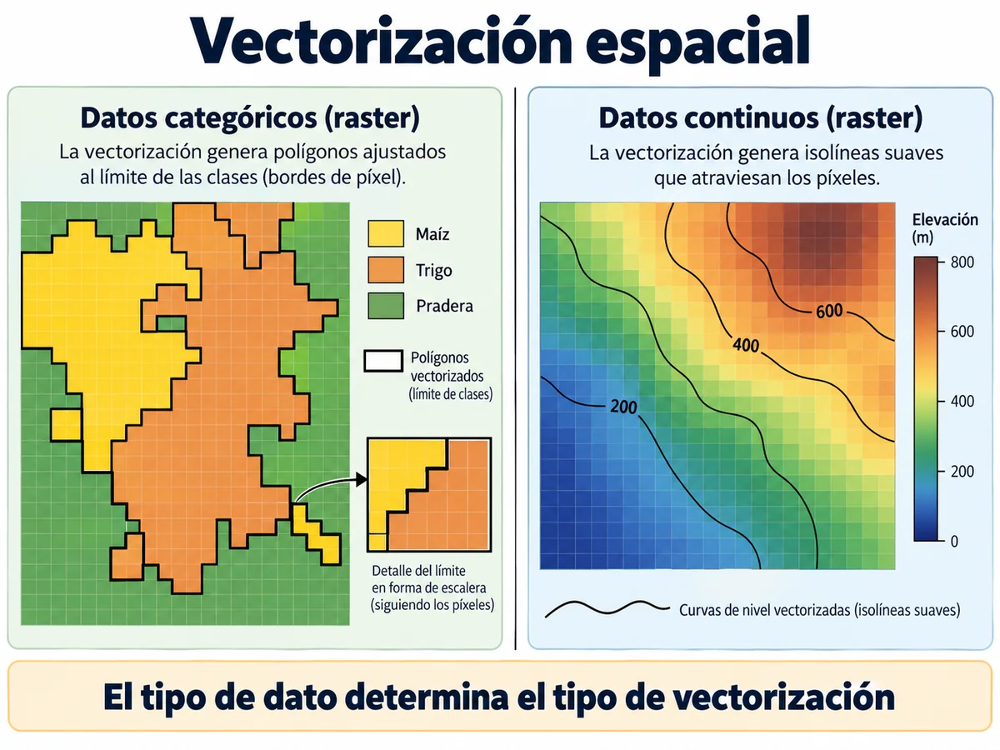

# Interacciones ráster–vector

!!! question "Pregunta guía"
    ¿Cómo obtengo el NDVI medio de cada cuartel, o convierto un mapa de clases en polígonos que pueda editar?

!!! warning "Capítulo en preparación"
    Esta página muestra el esquema del capítulo: qué preguntas responderá, qué secciones tendrá y de qué material se escribirá. Mientras tanto, el [panorama (capítulo 1)](01-panorama.md) cubre lo esencial del tema.

## Objetivos

Al terminar, podrás:

1. Recortar y enmascarar un ráster con polígonos.
2. Extraer valores de un ráster en puntos, a lo largo de líneas y dentro de polígonos.
3. Rasterizar puntos, líneas y polígonos.
4. Vectorizar un ráster a polígonos, puntos y curvas de nivel.
5. Calcular distancias a la geometría más cercana.

## Esquema del capítulo

**1. Enmascarar y recortar**

- `rasterio.mask` con `crop=True` y su efecto en el `transform`.

**2. Extracción**

- A puntos (`sample`).
- A líneas: perfiles de elevación.
- A polígonos: estadísticas zonales y la regla de píxeles de borde (`all_touched`).

**3. Rasterización**

- Puntos (conteos, sumas).
- Líneas y polígonos (`rasterio.features.rasterize`).

**4. Vectorización**

- Ráster a polígonos (`shapes`).
- Ráster a puntos.
- Ráster a curvas de nivel: puente al [capítulo 9](09-curvas-de-nivel/index.md).

**5. Distancia a la geometría más cercana**

## Ejemplo agronómico previsto

Calcular NDVI medio, desviación y cobertura por cuartel; trazar un perfil de elevación a lo largo de una hilera; convertir un mapa de zonas de manejo en polígonos.

## Material base

- PDF del curso: *5. Interacciones ráster–vector*.
- Secciones 6.5, 6.6 y 7 del [capítulo 1](01-panorama.md).

## Referencias

1. Lovelace, R., Nowosad, J. y Muenchow, J. *Geocomputation with Python*. Libro abierto: [py.geocompx.org](https://py.geocompx.org/). Capítulo 6.
2. [Rasterio: features](https://rasterio.readthedocs.io/en/stable/topics/features.html).
3. [rasterstats](https://pythonhosted.org/rasterstats/).
