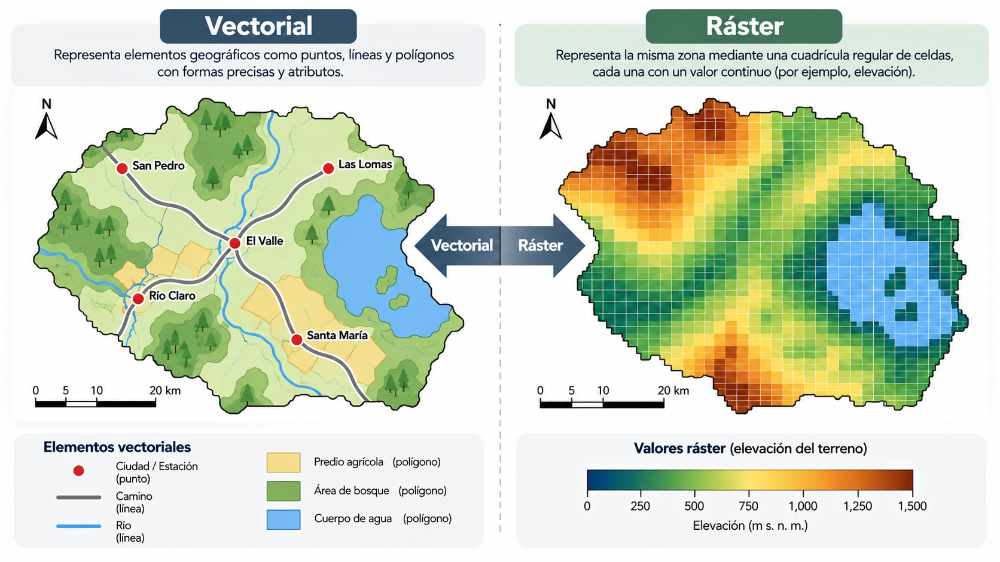
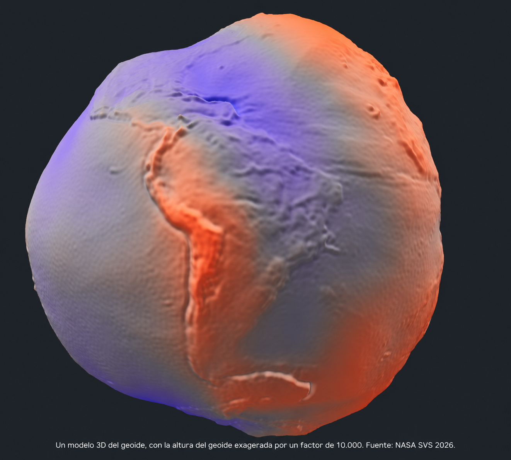
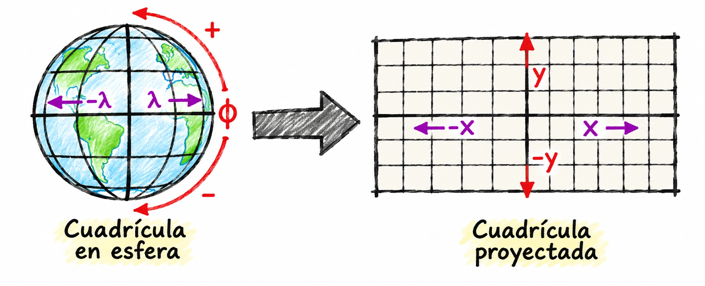
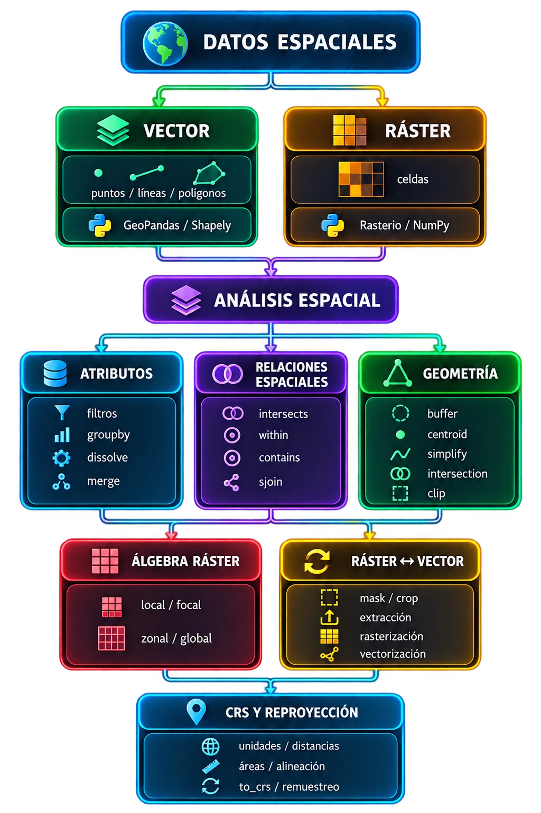

# Datos geográficos y sistemas de referencia de coordenadas

## 1. Propósito del material

Este material de estudio presenta los conceptos fundamentales necesarios para comprender cómo se representan, georreferencian y analizan los datos geográficos en ciencias de datos geoespaciales.

Los datos geográficos tienen una característica que los distingue de otros tipos de datos: además de describir **qué existe**, permiten representar **dónde se encuentra**. En ciencias agronómicas, esta dimensión espacial es especialmente relevante porque numerosas variables y procesos presentan una distribución espacial, entre ellos las propiedades del suelo, la elevación, la pendiente, la disponibilidad hídrica, el vigor de los cultivos, la productividad, la temperatura, la precipitación y la incidencia de plagas.

A lo largo del documento se abordan los modelos de datos vectorial y ráster, los sistemas de referencia de coordenadas y los criterios básicos para trabajar correctamente con ellos en Python.

### Objetivos de aprendizaje

Después de estudiar este material, se espera que el lector pueda:

- distinguir datos espaciales vectoriales y ráster;
- reconocer los componentes espaciales y de atributos de un conjunto de datos;
- comprender qué representa un sistema de referencia de coordenadas o **CRS/SRC**;
- distinguir sistemas de coordenadas geográficos y proyectados;
- comprender los conceptos de latitud, longitud, elipsoide, datum y proyección;
- interpretar códigos EPSG;
- reconocer por qué el CRS condiciona los cálculos de distancia, superficie y buffer;
- consultar y transformar CRS utilizando Python.

---

## 2. ¿Qué son los datos geográficos?

Un **dato geográfico** representa una entidad, característica o fenómeno que posee una localización espacial.

Podemos considerar dos componentes principales:

- **Componente espacial o geométrico:** indica dónde está la entidad y, eventualmente, cuál es su forma.
- **Componente de atributos:** contiene las características descriptivas asociadas a esa entidad.

Por ejemplo:

| parcela | cultivo | superficie_ha | rendimiento_t_ha | geometría |
|---|---|---:|---:|---|
| A01 | Trigo | 12.4 | 6.8 | Polígono |
| A02 | Maíz | 8.7 | 11.2 | Polígono |
| A03 | Pradera | 21.3 | 9.4 | Polígono |

Los campos `cultivo`, `superficie_ha` y `rendimiento_t_ha` son atributos. La columna `geometría` permite conocer la localización y delimitación de cada parcela.

---

## 3. Modelos fundamentales de datos geográficos

Existen dos formas principales de representar la información espacial:

1. **Modelo vectorial**
2. **Modelo ráster**



### 3.1 Modelo vectorial

El modelo vectorial representa entidades mediante geometrías construidas a partir de coordenadas.

Las geometrías fundamentales son:

- **Puntos**
- **Líneas**
- **Polígonos**

#### Puntos

Representan localizaciones cuya dimensión espacial puede considerarse despreciable respecto de la escala de análisis.

Ejemplos agronómicos:

- estaciones meteorológicas;
- puntos de muestreo de suelo;
- árboles individuales;
- pozos;
- trampas de insectos;
- puntos de medición GPS.

#### Líneas

Representan elementos cuya principal característica espacial es su longitud.

Ejemplos:

- canales de riego;
- caminos;
- drenajes;
- cursos de agua;
- transectos de muestreo.

#### Polígonos

Representan superficies delimitadas.

Ejemplos:

- predios;
- potreros;
- cuarteles agrícolas;
- unidades de suelo;
- zonas de manejo;
- cuencas hidrográficas.

---

## 4. Modelo ráster

El modelo ráster representa el espacio mediante una **matriz regular de celdas o píxeles**.

Cada celda contiene un valor.

Por ejemplo:

```text
105  108  110  115
102  107  112  118
 98  104  111  120
 95  101  108  116
```

Si el ráster corresponde a elevación, cada número podría representar metros sobre el nivel del mar.

### Ejemplos agronómicos de información ráster

Un ráster puede representar variables continuas como:

- elevación;
- temperatura;
- precipitación;
- humedad del suelo;
- índice NDVI;
- reflectancia espectral;
- productividad interpolada.

También puede representar variables categóricas:

- uso de suelo;
- cobertura vegetal;
- clases de suelo;
- clases de aptitud agrícola.

---

## 5. Resolución espacial en datos ráster

La **resolución espacial** corresponde al tamaño de las celdas.

Ejemplos:

- resolución de 10 m → cada píxel representa aproximadamente 10 × 10 m;
- resolución de 30 m → cada píxel representa aproximadamente 30 × 30 m;
- resolución de 1 km → cada píxel representa aproximadamente 1 × 1 km.

Una resolución espacial más pequeña permite representar mayor detalle, aunque implica almacenar y procesar más celdas.

Conceptualmente:

```text
Ráster = matriz de valores + información de georreferenciación
```

La georreferenciación incluye:

- sistema de referencia de coordenadas;
- origen;
- resolución;
- dimensiones;
- transformación espacial.

---

## 6. Vector versus ráster

| Característica | Vector | Ráster |
|---|---|---|
| Representación | Puntos, líneas, polígonos | Celdas |
| Límites discretos | Muy apropiado | Dependen de resolución |
| Fenómenos continuos | Menos natural | Muy apropiado |
| Parcelas agrícolas | Excelente | Posible |
| Elevación | Posible | Excelente |
| Imágenes satelitales | No | Excelente |
| Redes de canales | Excelente | Posible |
| NDVI | Posible | Excelente |

En ciencias ambientales y agrícolas es habitual trabajar con ambos modelos simultáneamente.

```text
Imagen Sentinel-2      → ráster
Límite de un predio    → vector
Muestreos de suelo     → puntos vectoriales
Red de drenaje         → líneas vectoriales
Modelo de elevación    → ráster
```

---

## 7. El problema de las coordenadas

Supongamos que encontramos el siguiente punto:

```text
(-73.05, -36.82)
```

Los números por sí solos no permiten interpretar completamente la posición.

Necesitamos saber:

- qué representan;
- cuál es su unidad;
- desde qué origen se miden;
- qué modelo de la Tierra se utiliza;
- qué sistema de coordenadas está asociado.

Aquí aparece el concepto de **Sistema de Referencia de Coordenadas**.

---

## 8. ¿Qué es un CRS?

Un **Coordinate Reference System (CRS)** o **Sistema de Referencia de Coordenadas (SRC)** define cómo las coordenadas de un objeto espacial se relacionan con la superficie terrestre.

```text
(x, y) + CRS → posición geográfica interpretable
```

Los CRS se dividen principalmente en:

1. **CRS geográficos**
2. **CRS proyectados**

---

## 9. Sistemas de coordenadas geográficos

Un CRS geográfico representa posiciones sobre una superficie aproximadamente esférica o elipsoidal mediante:

- **longitud**;
- **latitud**.

La longitud mide una distancia angular Este-Oeste respecto del meridiano de referencia.

La latitud mide una distancia angular Norte-Sur respecto del plano ecuatorial.

Ejemplo:

```text
Longitud = -73.05°
Latitud  = -36.82°
```

Las unidades son **grados**, no metros.

Esto es importante porque un grado no representa una distancia constante en todas las regiones del planeta.

---

## 10. Elipsoide, datum y geoide

### 10.1 Elipsoide

La Tierra no es una esfera perfecta. Una aproximación más adecuada es un **elipsoide**, definido principalmente mediante sus dimensiones ecuatorial y polar.

### 10.2 Datum

El **datum geodésico** define cómo ese elipsoide se posiciona y relaciona con la Tierra.

En términos simples:

> El elipsoide describe una superficie matemática; el datum establece cómo esa superficie se relaciona con la Tierra real.

### 10.3 Geoide

El **geoide** puede entenderse como una representación física de la superficie equipotencial asociada aproximadamente al nivel medio global del mar.




---

## 11. WGS 84

Uno de los sistemas más importantes en análisis geoespacial es:

**WGS 84 — EPSG:4326**

Es ampliamente utilizado por:

- GPS;
- bases de datos globales;
- aplicaciones web;
- numerosos productos vectoriales y ráster.

En Python puede aparecer como:

```text
Geographic 2D CRS: EPSG:4326
Name: WGS 84
Latitude: degree
Longitude: degree
```

---

## 12. Sistemas de coordenadas proyectados

Para representar la Tierra sobre un plano se utiliza una **proyección cartográfica**.

Un CRS proyectado transforma posiciones de la superficie terrestre a un sistema cartesiano:

```text
(x, y)
```

o, frecuentemente:

```text
(Easting, Northing)
```

Sus unidades suelen ser lineales, por ejemplo metros.

Ejemplo:

```text
Easting: 682350 m
Northing: 5924100 m
```

---

## 13. Toda proyección introduce distorsión

No es posible transformar una superficie curva en un plano sin introducir deformaciones.

Una proyección puede alterar:

- superficie;
- distancia;
- dirección;
- forma.

Según la propiedad que preservan, pueden distinguirse proyecciones:

- **equivalentes o equal-area**: preservan superficie;
- **equidistantes**: preservan determinadas distancias;
- **conformes**: preservan localmente formas y ángulos;
- **azimutales**: preservan determinadas direcciones.

Por ello, la pregunta correcta no es:

> ¿Cuál es la mejor proyección?

sino:

> **¿Qué propiedad necesito preservar para mi análisis?**

---

## 14. Ejemplo agronómico: superficie de un predio

Supongamos que queremos calcular la superficie de un predio agrícola y tenemos sus límites en:

```text
EPSG:4326
```

Si aplicamos directamente:

```python
predio.area
```

el resultado estará expresado en unidades asociadas al CRS geográfico, no en metros cuadrados.

Para obtener una superficie útil en agricultura:

```text
Predio en EPSG:4326
        ↓
reproyección
        ↓
CRS proyectado apropiado
        ↓
cálculo de área
        ↓
m²
        ↓
÷ 10 000
        ↓
hectáreas
```

---

## 15. El sistema UTM

Uno de los sistemas proyectados más utilizados para análisis locales y regionales es **UTM — Universal Transverse Mercator**.

La Tierra se divide longitudinalmente en zonas. Cada zona utiliza una proyección adaptada a su región para reducir distorsiones.

Las coordenadas suelen expresarse en:

```text
Easting
Northing
```

y normalmente utilizan metros como unidad.

Esto permite realizar cálculos como:

```python
distancia = puntos.distance(otro_punto)
area = parcelas.area
buffer = canales.buffer(100)
```

Siempre debe utilizarse la zona UTM adecuada para el área de estudio.

---

## 16. Importancia agronómica del CRS

Supongamos que queremos responder:

> ¿Qué superficie cultivada se encuentra a menos de 100 metros de un canal de riego?

El procedimiento conceptual sería:

```text
Canal
  ↓
buffer de 100 m
  ↓
intersección con parcelas agrícolas
  ↓
cálculo de superficie
```

El valor `100` representa 100 metros solo si las unidades del CRS son metros.

Si los datos están en EPSG:4326:

```python
canal.buffer(100)
```

el valor se interpretaría en grados, por lo que el resultado sería incorrecto para un buffer de 100 m.

---

## 17. Compatibilidad espacial entre capas

Supongamos que disponemos de:

```text
Parcelas agrícolas     → EPSG:A
Imagen satelital       → EPSG:B
Modelo de elevación    → EPSG:C
```

Aunque representen el mismo territorio, no necesariamente pueden combinarse correctamente mientras utilicen diferentes sistemas de referencia.

Antes de realizar:

- intersecciones;
- extracción ráster;
- recortes;
- joins espaciales;
- distancias;
- buffers;

debemos comprobar sus CRS.

---

## 18. ¿Qué es EPSG?

Los CRS se identifican de forma estandarizada mediante expresiones como:

```text
EPSG:4326
```

La estructura general es:

```text
AUTORIDAD:CÓDIGO
```

Un código EPSG actúa como identificador de una definición formal de sistema de referencia de coordenadas.

---

## 19. EPSG versus WKT

Aunque identificadores como `EPSG:4326` son muy prácticos, un CRS contiene más información.

El formato **WKT — Well Known Text** puede representar:

- datum;
- elipsoide;
- meridiano de referencia;
- ejes;
- unidades;
- método de proyección;
- parámetros;
- área de aplicación.

En el trabajo cotidiano no es necesario memorizar la definición WKT completa, pero sí comprender que un código EPSG referencia una definición mucho más extensa.

---

## 20. CRS en Python

En GeoPandas, el CRS puede consultarse mediante:

```python
gdf.crs
```

Por ejemplo:

```python
world.crs
```

Para saber si el CRS es geográfico:

```python
world.crs.is_geographic
```

Para obtener la autoridad y código:

```python
world.crs.to_authority()
```

Un resultado posible sería:

```text
('EPSG', '4326')
```

---

## 21. `set_crs()` no es lo mismo que `to_crs()`

### `set_crs()`

Asigna o corrige la **definición** del CRS.

```python
gdf = gdf.set_crs(4326)
```

No modifica las coordenadas.

Conceptualmente significa:

> Estas coordenadas deben interpretarse utilizando este CRS.

### `to_crs()`

Transforma las coordenadas desde un CRS a otro.

```python
gdf_utm = gdf.to_crs(32718)
```

Conceptualmente:

```text
set_crs()
↓
define qué significan los números

to_crs()
↓
calcula nuevos números para representar
la misma localización en otro CRS
```

---

## 22. Reproyección

La **reproyección** consiste en transformar las coordenadas desde un CRS hacia otro conservando la localización geográfica de las entidades.

Por ejemplo:

```python
gdf_utm = gdf.to_crs(32718)
```

Después de la transformación:

```text
antes:
(-73.05, -36.82)

después:
(x metros, y metros)
```

Las coordenadas cambian, pero la posición geográfica representada sigue siendo la misma.

---

## 23. El CRS adecuado depende del objetivo

No existe un único CRS óptimo para todas las tareas.

| Objetivo | CRS conveniente |
|---|---|
| GPS / intercambio global | WGS84 |
| visualización web | CRS compatible con web |
| medir superficie agrícola | CRS proyectado apropiado |
| calcular buffers | CRS proyectado |
| análisis regional | CRS proyectado regional |
| integración de capas | CRS común |

Dentro de un mismo proyecto es válido utilizar distintos CRS para distintas etapas.

---

## 24. Caso aplicado: agricultura de precisión

Supongamos que disponemos de:

- límites vectoriales de un predio;
- puntos de muestreo de suelo;
- un modelo digital de elevación;
- una imagen Sentinel-2;
- líneas de drenaje;
- puntos de rendimiento de una cosechadora.

Una estrategia de trabajo podría ser:

```text
1. Revisar CRS de cada dataset
             ↓
2. Identificar área común de estudio
             ↓
3. Seleccionar CRS de trabajo
             ↓
4. Reproyectar las capas necesarias
             ↓
5. Realizar análisis espacial
             ↓
6. Calcular distancias y superficies
             ↓
7. Generar mapas y resultados
```

Un análisis puede ser estadísticamente correcto y, aun así, ser geográficamente incorrecto si los CRS se manejan mal.

---

## 25. Errores frecuentes

### Error 1: creer que las coordenadas contienen por sí solas toda la información

```text
x = -73
y = -36
```

Sin CRS, estas coordenadas son ambiguas.

### Error 2: interpretar grados como metros

```python
gdf.buffer(100)
```

si `gdf.crs` es EPSG:4326.

### Error 3: calcular áreas directamente en longitud/latitud

```python
gdf.area
```

si los datos están en un CRS geográfico.

### Error 4: superponer capas sin verificar sus CRS

Dos capas pueden representar el mismo territorio y aun así utilizar coordenadas numéricamente muy diferentes.

### Error 5: utilizar `set_crs()` para reproyectar

```python
gdf.set_crs(32718)
```

cuando las coordenadas originales corresponden a EPSG:4326.

Esto cambia la definición del CRS, pero no transforma las coordenadas.

### Error 6: pensar que EPSG:4326 siempre es el mejor CRS

WGS84 es muy útil para intercambio y posicionamiento global, pero no necesariamente para medir superficies, distancias o generar buffers.

---

## 26. Secuencia recomendada antes de cualquier análisis

Un hábito recomendable es comenzar con:

```python
print(gdf.crs)
```

y preguntarse:

1. ¿Tiene CRS?
2. ¿Es geográfico o proyectado?
3. ¿Cuáles son sus unidades?
4. ¿El CRS es apropiado para el territorio?
5. ¿El CRS es apropiado para la operación?
6. ¿Todas las capas utilizan un CRS compatible?

---

## 27. Ejemplo básico en GeoPandas

```python
import geopandas as gpd

parcelas = gpd.read_file("parcelas.gpkg")

print(parcelas.crs)
```

Para saber si el CRS es geográfico:

```python
parcelas.crs.is_geographic
```

Para conocer las unidades:

```python
parcelas.crs.axis_info
```

Para reproyectar:

```python
parcelas_proj = parcelas.to_crs(32718)
```

Para calcular superficie:

```python
parcelas_proj["area_m2"] = parcelas_proj.area
parcelas_proj["area_ha"] = parcelas_proj["area_m2"] / 10000
```

La secuencia lógica es:

```text
leer datos
   ↓
comprobar CRS
   ↓
seleccionar CRS adecuado
   ↓
reproyectar cuando corresponda
   ↓
realizar cálculos geométricos
```

---

## 28. CRS y datos ráster

Los ráster también poseen un CRS.

Con `rasterio`:

```python
import rasterio

src = rasterio.open("dem.tif")

print(src.crs)
```

En un ráster también necesitamos conocer:

- número de filas y columnas;
- tamaño de píxel;
- origen;
- transformación espacial.

Conceptualmente:

```text
ráster = valores + transformación espacial + CRS
```

---

## 29. Ideas clave para estudiar

1. Los datos geográficos combinan información temática con localización espacial.
2. Vector y ráster son modelos diferentes pero complementarios.
3. Las coordenadas solo son interpretables correctamente cuando conocemos su CRS.
4. Un CRS geográfico utiliza coordenadas angulares, normalmente longitud y latitud.
5. Un CRS proyectado utiliza coordenadas cartesianas sobre una representación plana.
6. Toda proyección introduce algún tipo de distorsión.
7. El CRS apropiado depende del propósito del análisis.
8. Para calcular distancias, áreas y buffers con geometría planar, normalmente necesitamos un CRS proyectado adecuado.
9. `set_crs()` define el CRS; `to_crs()` transforma las coordenadas.
10. Antes de combinar capas espaciales debemos comprobar que sus sistemas de referencia sean compatibles.

---

## 30. Preguntas de autoevaluación

1. ¿Qué diferencia fundamental existe entre un dato convencional y un dato geográfico?
2. ¿Qué tipos de geometría utiliza el modelo vectorial?
3. ¿Qué representa una celda en un modelo ráster?
4. ¿Qué significa resolución espacial?
5. ¿Qué información necesita un ráster para ubicarse correctamente sobre la Tierra?
6. ¿Qué es un sistema de referencia de coordenadas?
7. ¿Cuál es la diferencia entre un CRS geográfico y uno proyectado?
8. ¿En qué unidades se expresan normalmente las coordenadas de EPSG:4326?
9. ¿Qué función cumple un datum?
10. ¿Por qué las proyecciones producen distorsiones?
11. ¿Por qué no deberíamos calcular directamente la superficie de una parcela en EPSG:4326?
12. ¿Qué es un código EPSG?
13. ¿Cuál es la diferencia entre `set_crs()` y `to_crs()`?
14. ¿Qué debería hacerse antes de calcular un buffer de 100 m?
15. ¿Por qué dos capas del mismo territorio podrían no superponerse correctamente?

---

## 31. Esquema conceptual

  
<small>
El esquema resume cómo se conectan los temas del libro. Todo parte de los **datos espaciales**, que se representan como **vector** (puntos, líneas y polígonos, con GeoPandas y Shapely) o como **ráster** (celdas, con Rasterio y NumPy). Sobre ellos se hace el **análisis espacial**, que se divide en tres frentes: los **atributos** (filtros, `groupby`, `dissolve`, `merge`), las **relaciones espaciales** (`intersects`, `within`, `contains`, `sjoin`) y la **geometría** (`buffer`, `centroid`, `simplify`, `intersection`, `clip`). A continuación vienen el **álgebra ráster** (operaciones locales, focales, zonales y globales) y la **interacción ráster-vector** (máscara y recorte, extracción, rasterización y vectorización). Todo el flujo se apoya en el **CRS y la reproyección**, que definen las unidades, las distancias y las áreas, y garantizan que las capas estén alineadas.
</small>
---

## Referencias

Este material se basa principalmente en:

- *Geocomputación con Python*, capítulo 1: **Datos geográficos en Python**.
- *Geocomputación con Python*, capítulo 6: **Reproyección de datos geográficos**.