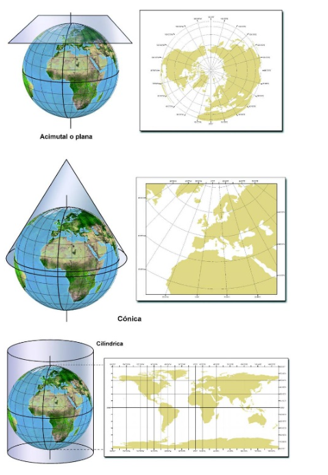

# Datos geográficos y sistemas de referencia de coordenadas

## 1. Propósito y objetivos

Los datos geográficos describen **qué existe, dónde se encuentra y cómo se distribuye**. En agronomía permiten relacionar parcelas, canales, muestreos de suelo e imágenes de vegetación para responder preguntas sobre un territorio.

Este material introduce los modelos vectorial y ráster, su representación en Python y las decisiones necesarias para medir e integrar capas correctamente. Al finalizar, deberías poder:

- distinguir geometría, atributos, valores y metadatos;
- explicar la relación entre elipsoide, datum, coordenadas y proyección;
- interpretar un CRS y justificar su elección para un área y una operación;
- diferenciar asignación de CRS, reproyección y remuestreo;
- reconocer la georreferenciación, alineación y ausencia de datos en un ráster;
- seguir un análisis reproducible de superficie próxima a un canal.

Se utiliza **SRC** (sistema de referencia de coordenadas) y su equivalente inglés **CRS** (*Coordinate Reference System*). Los ejemplos de código requieren Python con GeoPandas, Shapely, Rasterio y NumPy. Las primeras secciones contienen fragmentos explicativos; el ejemplo de la sección 8 es autónomo y utiliza datos sintéticos.

--- 

## 2. Dos modelos para representar el territorio


### 2.1. Modelo vectorial: entidades con geometría y atributos

Cada entidad ocupa una fila de una tabla y tiene una geometría asociada.

| Geometría | Qué representa | Ejemplo agronómico |
|---|---|---|
| Punto | Una localización | Muestreo de suelo o estación meteorológica |
| Línea | Una trayectoria | Canal, camino o drenaje |
| Polígono | Una superficie delimitada | Parcela, predio o zona de manejo |

La elección depende de la escala: un árbol puede representarse como punto en un predio o como polígono de copa en un estudio detallado. Las geometrías múltiples, como `MultiPolygon`, permiten representar varias partes dentro de una misma entidad.

| parcela | cultivo | rendimiento_t_ha | geometría |
|---|---|---:|---|
| A01 | Trigo | 6.8 | Polígono |
| A02 | Maíz | 11.2 | Polígono |

`cultivo` y `rendimiento_t_ha` son atributos; la geometría contiene las coordenadas que delimitan cada parcela. Una superficie guardada como atributo puede proceder de otra fuente o fecha: no equivale necesariamente al área calculada desde la geometría actual.

### 2.2. Modelo ráster: valores sobre una cuadrícula

Un ráster regular representa el espacio mediante filas y columnas de celdas. Cada celda contiene un valor **por banda**. Una imagen puede tener varias bandas, por ejemplo rojo e infrarrojo cercano.

| Tipo de variable | Ejemplos | Interpretación |
|---|---|---|
| Continua | Elevación, temperatura, reflectancia, NDVI | La magnitud numérica tiene significado |
| Categórica | Cobertura o clase de suelo | El número identifica una categoría |

Los códigos de clases no se deben promediar como si fueran magnitudes. El promedio de los códigos «1 = bosque» y «3 = cultivo» no representa una cobertura intermedia.

El tamaño de celda determina la **resolución espacial de la cuadrícula**. En un CRS métrico, una celda cuadrada de 10 m ocupa 100 m² en el plano. Si la resolución se expresa en grados, su tamaño terrestre varía con la ubicación. Una cuadrícula más fina exige más memoria y no garantiza información más exacta: remuestrear un producto de 30 m a 10 m no crea observaciones nuevas.

### 2.3. Cómo elegir y combinar los modelos

Los vectores resultan prácticos para límites y redes; los rásteres, para superficies muestreadas regularmente e imágenes. No son categorías excluyentes: el NDVI puede almacenarse como imagen y también como un promedio asociado a cada parcela.

Un análisis habitual combina **polígonos de parcelas + ráster de vegetación**, extrayendo una estadística para cada polígono. Antes de hacerlo hay que comprobar ubicación, CRS, resolución y datos válidos.

---

## 3. De las coordenadas a una posición interpretable

El par `(-73.05, -36.82)` no identifica por sí solo una posición inequívoca. Se necesitan las unidades, los ejes y el sistema que relaciona esas coordenadas con la Tierra.

### 3.1. Elipsoide, datum y geoide

| Concepto | Función | Relación con los demás |
|---|---|---|
| Elipsoide | Aproximar matemáticamente la forma terrestre mediante una superficie achatada | Proporciona la superficie sobre la que se definen coordenadas geodésicas |
| Datum geodésico o marco de referencia | Vincular el sistema de coordenadas con la Tierra | Establece su posición y orientación; compartir elipsoide no basta para compartir referencia |
| Geoide | Representar una superficie equipotencial del campo gravitatorio, cercana al nivel medio del mar | Sirve como referencia para determinadas alturas; no es lo mismo que un elipsoide |
| CRS | Especificar la referencia y el sistema de coordenadas, incluidos ejes y unidades | Permite interpretar las coordenadas; un CRS proyectado incorpora además una proyección |

La misma ubicación puede tener coordenadas distintas según el datum. Cambiar de referencia requiere una transformación adecuada; sustituir una etiqueta no mueve las coordenadas a su nueva representación. En trabajos de alta precisión también puede importar la época de las coordenadas.

Las alturas necesitan su propia referencia. La altura elipsoidal de un receptor GNSS y la elevación de un modelo del terreno no son automáticamente comparables. Esta distinción importa al integrar levantamientos y modelos digitales de elevación.

### 3.2. CRS geográficos y proyectados


Un **CRS geográfico** utiliza coordenadas angulares. La longitud expresa la posición angular respecto del meridiano de referencia; la latitud geodésica es el ángulo entre la normal al elipsoide y el plano ecuatorial. En el ejemplo, longitud y latitud negativas indican oeste y sur, respectivamente.

Un **CRS proyectado** representa posiciones sobre un plano mediante coordenadas como Este y Norte. Se deriva de un CRS geográfico usando una proyección y parámetros específicos. Sus unidades son lineales, frecuentemente metros, aunque también pueden ser pies.

Un grado de longitud representa distancias terrestres diferentes según la latitud. Por ello, los cálculos planos de GeoPandas en longitud/latitud no producen directamente metros ni hectáreas. Los métodos geodésicos pueden medir sobre el elipsoide, pero son un enfoque diferente de los cálculos planos que se usan aquí.

**Orden de coordenadas:** las geometrías de GeoPandas/Shapely emplean `(x, y)`; con longitud/latitud se construyen como `(longitud, latitud)`. Una definición formal de CRS puede declarar otro orden de ejes. Hay que distinguir esa definición de la convención de la biblioteca o del archivo utilizado.

### 3.3. EPSG y WKT

`EPSG:4326` es un identificador de autoridad y código para un CRS geográfico WGS 84 de dos dimensiones. Un código **referencia una definición**, no es una fórmula de transformación ni indica por sí solo la precisión de los datos.

**WKT** (*Well-Known Text*) permite expresar una definición extensa de CRS: referencia, elipsoide, ejes, unidades y, cuando corresponde, proyección y parámetros. Algunos CRS personalizados no tienen código EPSG. WKT también se usa para describir geometrías; son usos distintos del mismo nombre.

--- 

## 4. Elegir el CRS según el territorio y la operación

### 4.1. Qué distorsiona una proyección



Toda proyección introduce deformaciones. Tener unidades métricas permite interpretar unidades, pero no garantiza que cualquier medición sea adecuada en cualquier territorio.

| Propiedad | Qué conserva | Límite relevante |
|---|---|---|
| Equivalente | Superficies | Puede distorsionar formas y distancias |
| Conforme | Ángulos y forma local | No conserva necesariamente superficies |
| Equidistante | Determinadas distancias | No conserva todas las distancias entre cualquier par de puntos |
| Azimutal | Direcciones respecto de un centro | La propiedad debe interpretarse en relación con ese centro |

Por ejemplo, dos proyecciones métricas pueden dar superficies distintas para un territorio extenso. Para comparar superficies regionales conviene evaluar una proyección equivalente; para un predio pequeño puede ser suficiente un CRS local con distorsión baja. La elección depende de la tolerancia del análisis y de la extensión del área.

### 4.2. UTM: justificar zona, hemisferio y datum


UTM (*Universal Transverse Mercator*) es un sistema de proyecciones conformes organizado en 60 zonas longitudinales, generalmente de 6° de ancho. Es frecuente en análisis locales, dentro de su ámbito de uso, aproximadamente entre 80° S y 84° N.

Para el punto ilustrativo `(-73.05, -36.82)`:

1. La longitud lo sitúa en la zona 18, cuyo intervalo ordinario es de 78° O a 72° O.
2. La latitud lo sitúa en el hemisferio sur.
3. Si la referencia elegida es WGS 84, el CRS es **WGS 84 / UTM zona 18S, EPSG:32718**.

El código `32718` se utiliza en este documento por esa ubicación y referencia. No es un código universal para Chile ni para todos los datos UTM. Otros datums tienen otros identificadores; un proyecto que cruza zonas o abarca una gran extensión requiere evaluar otra solución.

### 4.3. Criterios de decisión

| Necesidad | Qué comprobar |
|---|---|
| Intercambio en longitud/latitud | Referencia, orden de coordenadas y requisitos del formato |
| Medir áreas o buffers de un predio | Unidades, zona de uso y distorsión local del CRS |
| Comparar superficies regionales | Conveniencia de una proyección equivalente |
| Integrar vector y ráster | Transformar las geometrías al CRS del ráster cuando sea suficiente |
| Combinar rásteres celda a celda | CRS y cuadrículas coincidentes: resolución, origen y cobertura de trabajo |

Usar distintos CRS en distintas etapas es válido. No es necesario reproyectar todas las capas cada vez que se abre un proyecto.

## 5. Objetos vectoriales y CRS en Python

### 5.1. Qué contiene cada objeto

| Objeto | Biblioteca | Contenido |
|---|---|---|
| Geometría individual | Shapely | Un punto, línea o polígono; no almacena por sí solo el CRS |
| `GeoSeries` | GeoPandas | Una serie de geometrías con referencia espacial asociada |
| `GeoDataFrame` | GeoPandas | Una tabla de atributos con una columna de geometría activa |

Una operación como `parcelas.area` devuelve una serie numérica; `parcelas.buffer(100)` devuelve una `GeoSeries`. No todas las operaciones conservan automáticamente la tabla de atributos.

### 5.2. Consultar antes de transformar

Este fragmento requiere un archivo propio, `parcelas.gpkg`:

```python
import geopandas as gpd

parcelas = gpd.read_file("parcelas.gpkg")
if parcelas.crs is None:
    raise ValueError("Falta el CRS: consultar la fuente antes de asignarlo")

print(parcelas.crs)
print(parcelas.crs.is_geographic)
print(parcelas.crs.axis_info)       # Ejes y unidades
print(parcelas.crs.to_authority())  # Puede devolver None
```

Los valores de coordenadas pueden dar pistas, pero no prueban el CRS. Si falta, hay que recurrir a la documentación o al proveedor de los datos.

### 5.3. Asignar y transformar son operaciones diferentes

| Método | Qué modifica | Cuándo usarlo |
|---|---|---|
| `set_crs()` | La definición asociada; conserva los números de las coordenadas | Se conoce el CRS original y falta su metadato |
| `to_crs()` | Las coordenadas y el CRS asociado | Se necesita otra representación espacial de los mismos objetos |

```python
# Solo si la fuente confirma que estas coordenadas son WGS 84:
parcelas = parcelas.set_crs("EPSG:4326")  # Cuando falta el CRS

# Requiere que el CRS de origen ya esté correctamente definido:
parcelas_utm = parcelas.to_crs("EPSG:32718")
parcelas_utm["area_ha"] = parcelas_utm.area / 10_000
```

El ejemplo anterior muestra dos situaciones conceptuales; no hay que asignar `4326` a cualquier archivo antes de transformarlo. Sobrescribir un CRS existente es una corrección de metadatos que exige evidencia de que la definición anterior era incorrecta.

## 6. Georreferenciación y datos válidos en un ráster

### 6.1. Valores, transformación y CRS

Para ubicar un ráster necesitamos sus **valores**, la **transformación que relaciona índices y coordenadas** y el **CRS que interpreta esas coordenadas**. También son importantes dimensiones, bandas, tipo numérico y valor de ausencia.

```python
import rasterio

# Fragmento para un archivo propio:
with rasterio.open("dem.tif") as src:
    print(src.crs, src.transform, src.res, src.bounds)
    print(src.width, src.height, src.count, src.nodata)
    elevacion = src.read(1, masked=True)
```

`read(1)` devuelve una matriz `(filas, columnas)`; `read()` devuelve `(bandas, filas, columnas)`. Las bandas se numeran desde 1 en Rasterio, mientras que los índices de las matrices NumPy comienzan en 0.

### 6.2. De una celda a su ubicación

Para una cuadrícula sin rotación y orientada al norte, el origen suele ser la **esquina superior izquierda**. Con tamaño de celda de 10 m, origen `(500000, 5900000)` y fila/columna comenzando en cero, el centro de una celda es:

- `x = 500000 + (columna + 0.5) × 10`
- `y = 5900000 - (fila + 0.5) × 10`

Así, el centro de la celda `(0, 0)` es `(500005, 5899995)`. La coordenada y disminuye al avanzar hacia abajo por las filas. La transformación afín guarda esa relación; para cuadrículas rotadas se utiliza su forma general.

```python
from rasterio.transform import from_origin, xy

transformacion = from_origin(500000, 5900000, 10, 10)
print(xy(transformacion, 0, 0))  # Centro: (500005.0, 5899995.0)
```

### 6.3. NoData no equivale a cero

`NoData` indica ausencia de una observación válida. Puede codificarse mediante un número reservado, por ejemplo `-9999`, o mediante una máscara. `NaN` es una representación numérica de valor no definido en matrices de punto flotante. Un cero puede ser un valor real y no debe eliminarse sin consultar los metadatos.

```python
import numpy as np

valores = np.array([0.0, 10.0, -9999.0])
validos = valores[valores != -9999.0]
print(validos.mean())  # 5.0: conserva el cero válido
```

`np.nanmean()` ignora `NaN`, pero no reconoce automáticamente un código como `-9999`. Con `src.read(1, masked=True)` se obtiene una matriz enmascarada que puede excluir los valores señalados como inválidos por el archivo. Antes de convertirla a `NaN`, hay que usar un tipo flotante.

## 7. Reproyección, remuestreo e interacción ráster-vector

### 7.1. Por qué reproyectar un ráster exige remuestrear

En vectores se transforman las coordenadas de los vértices. En un ráster regular, las posiciones transformadas generalmente no forman otra cuadrícula regular coincidente. Se define entonces una **cuadrícula de destino** y se estiman sus valores a partir del ráster original: ese cálculo es el remuestreo.

También se puede remuestrear sin cambiar de CRS, por ejemplo para alinear dos imágenes con distintos orígenes o tamaños de celda. En Rasterio, `rasterio.warp.reproject` permite ambos casos.

| Datos y propósito | Método habitual | Interpretación |
|---|---|---|
| Clases de cobertura | Vecino más cercano | Conserva códigos existentes |
| Clases al pasar a celdas mayores | Moda | Representa la clase dominante |
| Elevación o reflectancia al interpolar | Bilineal | Estima valores usando celdas próximas |
| Variable continua al agregar | Promedio | Resume los valores de la celda mayor |

El método debe corresponder al significado de la variable: promediar códigos de suelo carece de sentido; promediar cantidades totales tampoco necesariamente conserva el total. Hay que distinguir magnitudes intensivas, como temperatura, y extensivas, como producción total.

El procedimiento es: definir CRS y cuadrícula de destino, elegir método, calcular valores y actualizar metadatos —incluidos transformación, dimensiones y `NoData`—. Los bordes pueden incorporar celdas sin datos. Por esa modificación de los valores, cuando solo se necesita extraer información con polígonos suele ser preferible transformar los vectores al CRS del ráster.

### 7.2. Igual CRS no significa igual cuadrícula

Dos imágenes pueden compartir CRS y resolución, pero tener orígenes desplazados medio píxel. Sumar sus matrices por posición combinaría ubicaciones distintas. Para álgebra ráster se debe comprobar la correspondencia espacial entre celdas, además de dimensiones, bandas y validez de los valores.

### 7.3. Seleccionar, recortar y resumir

| Operación | Resultado | Ejemplo |
|---|---|---|
| Selección espacial | Conserva las entidades que cumplen una relación | Parcelas que intersectan una franja |
| Recorte vectorial | Conserva la parte geométrica dentro del límite | Porción de cada parcela próxima al canal |
| Máscara ráster | Marca como inválidas las celdas fuera de una geometría | Imagen limitada al predio |
| Estadística zonal | Resume valores por zona | NDVI medio por parcela |
| Rasterización | Convierte geometrías y atributos a una cuadrícula | Clase de manejo por píxel |
| Vectorización | Convierte celdas o regiones a geometrías | Polígonos de cobertura |

En extracciones por polígonos, incluir solo celdas cuyo centro cae dentro o incluir todas las tocadas (`all_touched=True`) puede cambiar el resultado, especialmente en parcelas pequeñas. Esta última opción no equivale a ponderar por la proporción exacta de celda cubierta. Al calcular frecuencias de clases, se deben excluir las celdas `NoData` del denominador válido.
## . Síntesis conceptual

  
<small>
Todo parte de los **datos espaciales**, que se representan como **vector** (puntos, líneas y polígonos, con GeoPandas y Shapely) o como **ráster** (celdas, con Rasterio y NumPy). Sobre ellos se hace el **análisis espacial**, que se divide en tres frentes: los **atributos** (filtros, `groupby`, `dissolve`, `merge`), las **relaciones espaciales** (`intersects`, `within`, `contains`, `sjoin`) y la **geometría** (`buffer`, `centroid`, `simplify`, `intersection`, `clip`). A continuación vienen el **álgebra ráster** (operaciones locales, focales, zonales y globales) y la **interacción ráster-vector** (máscara y recorte, extracción, rasterización y vectorización). Todo el flujo se apoya en el **CRS y la reproyección**, que definen las unidades, las distancias y las áreas, y garantizan que las capas estén alineadas.
</small>
---

## Referencias

Este material se basa principalmente en:

- *Geocomputación con Python*, capítulo 1: **Datos geográficos en Python**.
- *Geocomputación con Python*, capítulo 6: **Reproyección de datos geográficos**.