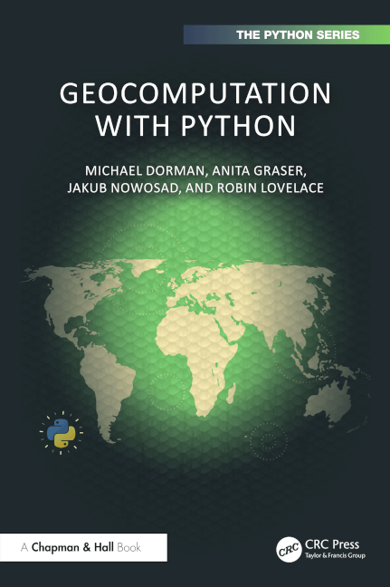

# GeoComputación con Python

El libro *Geocomputation with Python* (Dorman, Graser, Nowosad y Lovelace, 2025; Chapman & Hall/CRC, serie The Python Series) enseña a analizar datos geográficos con Python de forma reproducible y con software de código abierto. Se inspira en el movimiento FOSS4G (software libre para geoespacial).

## El contenido del libro

1. **Datos geográficos en Python:** modelos vectorial y ráster, y el papel del CRS.
2. **Operaciones con atributos:** filtrar, agregar y unir tablas con geometría.
3. **Operaciones espaciales:** relaciones entre geometrías, uniones espaciales y álgebra de mapas.
4. **Operaciones geométricas:** simplificar, centroides, buffers, transformaciones y recortes.
5. **Interacciones ráster-vector:** enmascarar, recortar, extraer valores y convertir entre ambos modelos.
6. **Reproyección:** sistemas de referencia, transformación de coordenadas y remuestreo de rásteres.
7. **E/S de datos:** lectura y escritura de datos geográficos.
8. **Mapas con Python:** visualización cartográfica.

Libro original: [py.geocompx.org](https://py.geocompx.org/)

En esta sección encontrarás apuntes de lo que he aprendido con el libro.